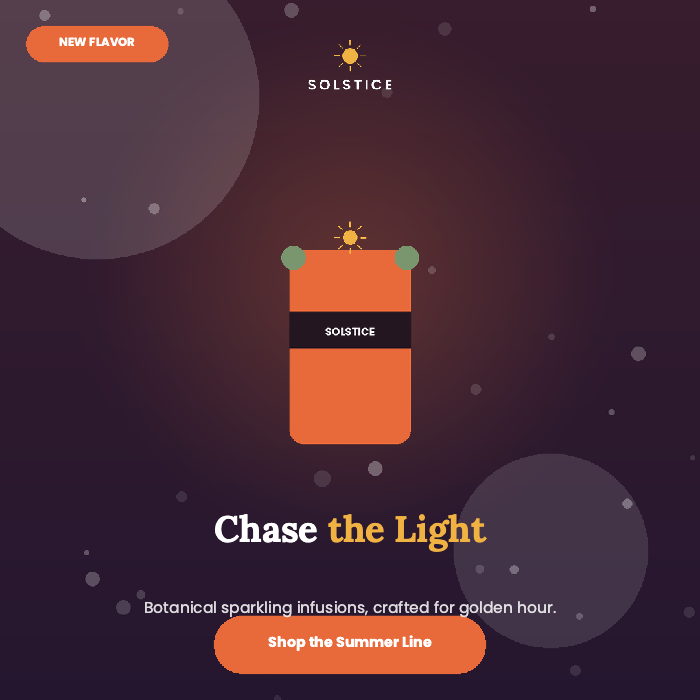
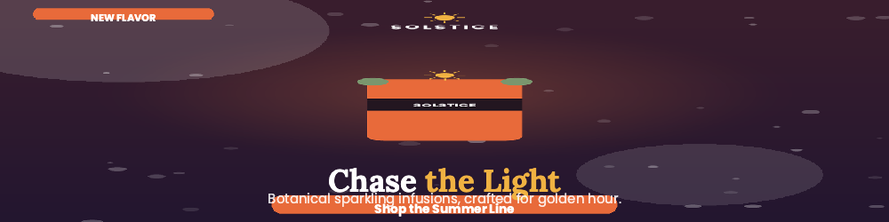
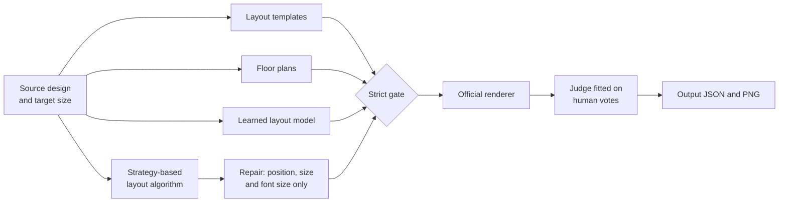
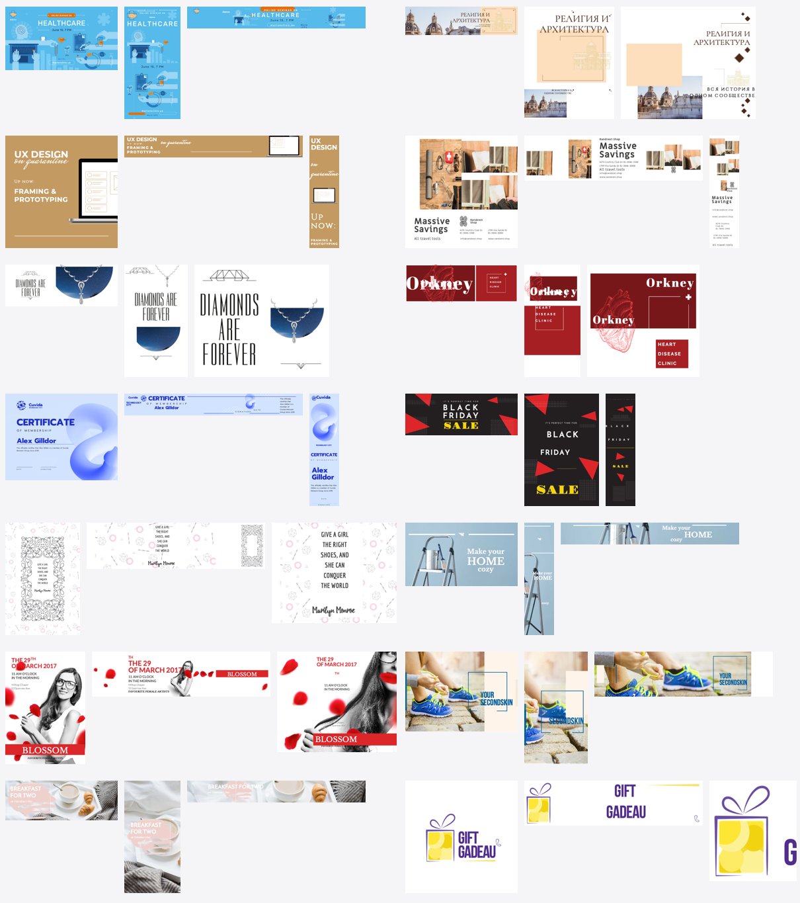
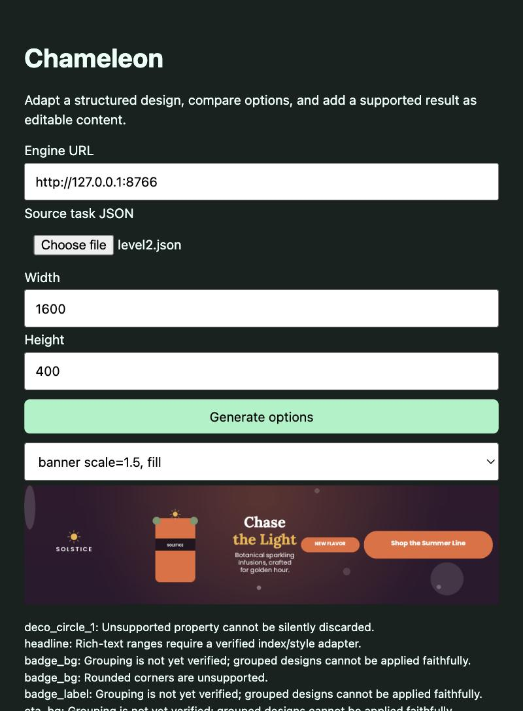
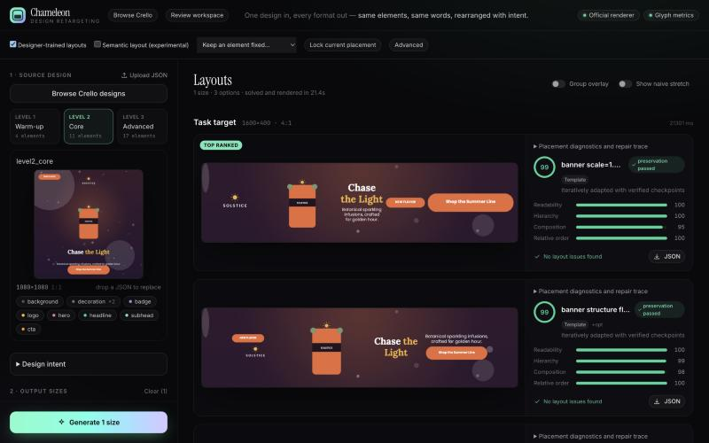

<div align="center">

# 🦎 Chameleon

### Any design. Every canvas.

**A resize engine that moves the furniture instead of stretching the picture.**<br>
Give it a finished design and a new canvas size. It rearranges the same elements so the result still looks designed.

Adobe University Hackathon: North America 2026 · Project Chameleon

**Team Roll Tide:** Gaurav Shrivastava · Pranay Joshi · Kavya Gupta

`Offline` · `Docker linux/amd64` · `No image generation` · `96.6% structurally clean on unseen designs`

</div>

<br>

| Level 1: 1080×1080 → 1080×1350 | Level 2: 1080×1080 → 1600×400 |
|:---:|:---:|
|  |  |

<div align="center">

**Level 3: 17 elements, 1080×1350 → 728×90**


</div>

## Quick start

The submission runs exactly the way scoring does:

```bash
docker build --platform linux/amd64 -t my-chameleon-engine .
```

```bash
docker run --rm --network none -v $(pwd)/input:/app/input -v $(pwd)/output:/app/output my-chameleon-engine
```

Each task in `input/` produces `output/<task>_output.json` and `output/<task>_output.png`. The image is about 1.2 GB and needs nothing from the network at run time.

Without Docker (Python 3.10+, with `git` installed):

```bash
python3 -m venv .venv
```

```bash
.venv/bin/pip install -r requirements.txt
```

```bash
.venv/bin/python -m engine.main
```

The three official samples are already in `input/`, so these commands work straight after cloning. To try your own design, add a task JSON to `input/`.

## Stretching versus moving the furniture

The same official sample and target, drawn by the official renderer:

| Original | Naive stretch | Chameleon |
|:---:|:---:|:---:|
|  |  |  |

## How it works

No single approach won. People preferred bold layouts that often broke the rules, and strictly legal layouts often looked timid. So the engine generates broadly, makes everything legal, then chooses the way people did.



1. **Generate.** Templates, constraint solving with OR-Tools, a transformer trained on real designs and a strategy-based layout algorithm produce a wide pool of layouts.
2. **Repair.** Layouts that break a rule are rebuilt on untouched copies of the source elements. Only position, size and font size can change.
3. **Gate.** Layouts failing the fewest structural checks stay, then those losing the fewest texts to tiny type. New overflow, text printed over text, newly hidden elements and lost contrast are ruled out whenever something else survives.
4. **Judge.** The survivors are drawn by the official renderer, and a small linear model picks one. It learned from human votes which qualities matter: larger type, content that uses the canvas, and a headline that keeps its presence.

The engine never refuses a task. If everything fails, the least bad layout comes back, and missing assets or unknown fonts don't crash it.

## Results

### On designs nothing was tuned on

146 fresh designs, 292 tasks, run once after every decision was frozen.

| Measure | Result |
|:---|---:|
| Pass every structural check | **282 of 292 (96.6%)** |
| Same measure on the voted designs | 145 of 152 (95.4%) |
| Tasks where some text draws under 3 px | 9 of 292 |
| Seconds per task, median / mean / slowest | 11.9 / 13.4 / 48.9 |

The two pass rates match, which is the check we care about most: there is no sign of overfitting. These checks are our own copy of the published rules, not the official scorer.

### Sample results

Twelve favourites, hand-picked by us from the layouts people voted best on designs held out from fitting. Each one also passed every structural check with no text lost. They show the engine at its best, so the numbers above are the fairer measure of a typical result.



<sub>Designs from the [Crello dataset](https://huggingface.co/datasets/cyberagent/crello) (CDLA-Permissive-2.0).</sub>

## How people shaped the engine

We didn't want a score we had written ourselves to decide what looks good, so the team built a voting tool and judged the engines by eye, round after round. Each round was a small effort, and together they set the direction of the final engine.

| Round | What we judged | Votes | What changed |
|:---|:---|---:|:---|
| **Pilot** | Our engine, Gaurav's and a hybrid of the two, names hidden | 53 | We replaced the hybrid with a merged engine |
| **Round 1** | Ours, Gaurav's and merged on 200 tasks, by a three-person panel voting blind (agreement κ = 0.73) | 600 | People preferred bold layouts that often broke the rules, and these votes trained the judge model |
| **Final round** | Final, merged and Gaurav's on 152 tasks held out from fitting | 456 | Confirmed the final engine, and we kept its judge as it was |

### What the votes taught us

- **Bold beats tidy.** In round 1, Gaurav's engine won 46% of picks, merged 38% and ours 25%. Larger type, content that uses the canvas and a strong headline decided the votes, while our own defect counts barely mattered.
- **Legal matters too.** Votes can't see the JSON rules, and many layouts people liked broke them. That led to the final design: generate broadly, repair everything, then choose the way people chose.
- **A model, not a pile of rules.** The judge is a small linear model fitted on 854 preferences from those votes. On designs held out from fitting, it predicts which of two layouts people picked about 69% of the time.

### The small things that kept the votes honest

- Engine names stayed hidden in the blind rounds, and options were shuffled by a seeded draw.
- Picture URLs carry a fingerprint, so a cached image can't appear under the wrong option.
- Every build checks each option against its engine's run before anyone votes.
- A core set covers every canvas shape evenly, from extreme wide to extreme tall.

### What people picked in the final round

| Engine | Picked as best | Passes every structural check |
|:---|---:|---:|
| **Final engine** | **60.5%** | **145 of 152** |
| Merged engine | 21.1% | 60 of 152 |
| Gaurav's v12 alone | 15.1% | 6 of 152 |

Ties count for both engines. In 12.5% of tasks every option was marked bad.

> **How far to trust this vote.** It reflects effectively one judge, because all three name rows received identical picks, and engine names were visible. Round 1, with three independent judges voting blind, is what the judge model was trained on.

## Keeping it general

The brief rules out anything hand-tailored to a design or a size. We held ourselves to that:

- No rules for specific designs or sizes. The only design ids in the code are three kept out of the layout library, so they can't leak into it.
- Any model change had to beat the old one on designs held out from fitting. Two new judge features and a refit on both vote rounds did not, so they were rejected.
- 146 designs were set aside and used only once, at the very end.
- Speedups had to reproduce the old layouts exactly. With time limits removed, 15 of 15 test tasks came out identical.

## Rules checklist

| Requirement | Status |
|:---|:---|
| Same element ids and count, nothing added or removed | ✅ Checked on every output |
| Text, fonts, colours and assets unchanged | ✅ Only position, size and font size are changed, plus crop fit on backgrounds |
| Nothing off-canvas | ✅ Checked on every output |
| Images kept in proportion | ✅ 1 miss in 292 unseen tasks |
| No regenerated or invented image content | ✅ No image generation anywhere |
| Runs offline in a standard container | ✅ Built from a fresh clone, run with `--network none` |
| Output matches `chameleon_design_schema_v0.9.json` | ✅ Validated |
| Model weights and dependencies accessible to evaluators | ✅ All weights ship in this repository and the Docker image |
| Read-me with approach and how to run | ✅ This file |
| Viewer add-on (required, not scored) | ✅ See below, with its limits |

## Viewer

### Express add-on

The add-on in [`express_addon/`](express_addon/) uploads a design, generates options from the final engine and previews them.



The viewer and add-on need the service's extra packages and Node.js. From the repository root, install them and start the service:

```bash
.venv/bin/pip install -r requirements-dev.txt
```

```bash
.venv/bin/uvicorn service.app:app --port 8765
```

Then, in a second terminal, start the add-on:

```bash
npm --prefix express_addon install
```

```bash
npm --prefix express_addon run dev
```

Then open http://127.0.0.1:5241, or sideload `express_addon/dist` using Adobe's add-on development tools.

**Current limits:** it has not been tested inside a live Adobe Express session. Writing a result into an Express document works only for simple designs, so groups, rich text and rounded corners show a clear explanation instead of being applied.

### Web viewer

Pick a sample or upload a design, choose sizes and generate. Each result can be compared with the original and a plain stretch, and downloaded as PNG or JSON. After `npm --prefix viewer install` and `npm --prefix viewer run build`, the service above serves it at http://127.0.0.1:8765. Restart the service if it was already running.



## Models and dependencies

Every model is small, runs on CPU and ships with the repository, so nothing is downloaded at run time.

| Model | File | Role |
|:---|:---|:---|
| Layout transformer | `engine/models/retarget.npz` (8.7 MB) | Proposes layouts; we trained it on Crello designs |
| Judge | `final/weights.json` | Linear model fitted on human votes; picks the final layout |
| Role classifier and layout library | `engine/models/roles*.json`, `engine/models/layouts*.json` | Identify what each element is and suggest arrangements |
| Second engine's role model | `vendor/gaurav/engine/models/roles.npz` | Used by the strategy-based layout algorithm; `FINAL_GAURAV=0` turns it off |

Python dependencies are in [`requirements.txt`](requirements.txt): Pillow, the official `cr-renderer`, OR-Tools, SciPy and jsonschema. The renderer's system libraries are installed by the [`Dockerfile`](Dockerfile).

### Inside the layout transformer

| | |
|:---|:---|
| **Task** | Takes a design and a target canvas, then places each element in turn |
| **Network** | Encoder-decoder transformer: 3 encoder layers and 4 decoder layers with cross-attention |
| **Size** | 192-dimensional tokens, 8 attention heads, 768-unit feed-forward layers |
| **Parameters** | 4.71 million: decoder 2.37M, encoder 1.33M, output heads 0.43M, embeddings and projections 0.57M |
| **Weights** | 8.7 MB in 16-bit floats; inference runs in NumPy on CPU, with no PyTorch needed |
| **Encoder input** | One token per element (up to 48), from 5 element types and 32 features, plus a 6-value global token with the source and target shapes |
| **Decoder output** | Five values per element (width, height, x, y, font size), each one of 256 bins relative to a plain stretch and conditioned on the values before it |
| **Sampling** | A greedy layout plus further samples, refined by a CP-SAT solver, then held to the same gate as every other source |
| **Training data** | 56,610 designer resize pairs from 1,401 Crello design families, split by family: 1,146 train, 94 validation, 161 test |
| **Training** | AdamW at a 3e-4 learning rate and batch size 64; the shipped weights are the best validation checkpoint, at step 11,500 |

On 500 held-out pairs, its greedy layout matches the designer's about as well as a plain stretch (IoU 0.411 versus 0.413), and the best of 8 samples reaches 0.453. Geometry alone doesn't capture design quality, so the model's job here is to add options, and the gate and judge decide what ships.

On 292 unseen tasks, the shipped layout started from the transformer 49% of the time. Floor plans supplied 15%, the strategy-based algorithm 13% and layout templates 23%.

The judge uses 21 features fitted on 854 human preferences, and predicts held-out preferences 68.7% of the time. The role classifier is a 48-tree ensemble over 16 features and 11 roles, with 62.7% accuracy per element on held-out data.

## Operating limits

- **Platform:** Docker on `linux/amd64`, with no network needed at run time. We tested on an Apple Silicon Mac under emulation, not on the exact scoring machine, whose limits are still to be published.
- **Speed:** about 12 s per task (median), and up to 49 s on our final test, running four tasks at a time.
- **Spaced type on thin canvases:** letter spacing can't be changed, so widely spaced text can get very small on strips such as 728×90.
- **Hairlines on extreme canvases:** thin rules that keep their proportions can fall under 1 px, which accounts for 9 of the 10 structural misses on unseen designs.
- **Run-to-run variation:** refinement works within a time budget, so results can differ slightly between runs.

## Team and credits

Team Roll Tide: Gaurav Shrivastava, Pranay Joshi and Kavya Gupta.

The strategy-based layout algorithm in [`vendor/gaurav/`](vendor/gaurav/) is Gaurav's work, copied from his [AdobeHackathon repository](https://github.com/GauravS11112003/AdobeHackathon) (private) at commit `4d76410`, so its development history is there rather than here.

## Repository map

| Path | What it holds |
|:---|:---|
| [`final/`](final/) | The submission engine: repair, gate and judge ([details](final/README.md)) |
| `engine/` | Our layout pipeline, checks and the starter's runner |
| `merged/` | Floor plans and growth rules |
| `vendor/gaurav/` | Gaurav Shrivastava's strategy-based layout algorithm, a source of layouts (`FINAL_GAURAV=0` turns it off) |
| `renderer/` | The official renderer |
| `service/`, `viewer/`, `express_addon/` | API, web viewer and add-on |
| `tools/`, `evaluation/`, `training/`, `tests/` | Judging tools, benchmarks, model training and tests |

More detail is in the [developer guide](docs/developer-guide.md).

To run the tests, install `requirements-dev.txt` as above, then:

```bash
.venv/bin/python -m unittest discover -s tests
```
