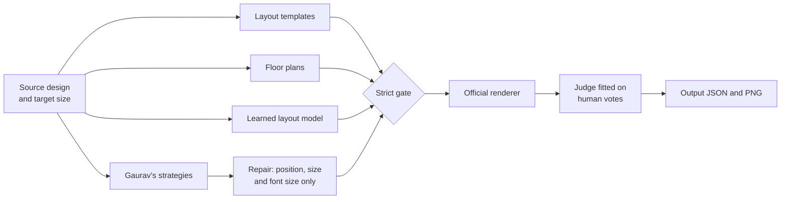

<div align="center">

# 🦎 Chameleon

### Any design. Every canvas.

**A resize engine that moves the furniture instead of stretching the picture.**<br>
Give it a finished design and a new canvas size. It rearranges the same elements so the result still looks designed.

Adobe University Hackathon: North America 2026 · Project Chameleon

`Offline` · `Docker linux/amd64` · `No image generation` · `96.6% structurally clean on unseen designs`

</div>

<br>

| Level 1: 1080×1080 → 1080×1350 | Level 2: 1080×1080 → 1600×400 |
|:---:|:---:|
|  |  |

<div align="center">

**Level 3: 17 elements, 1080×1350 → 728×90**


</div>

## Quick start

The submission runs exactly the way scoring does:

```bash
docker build --platform linux/amd64 -t my-chameleon-engine .
```

```bash
docker run --rm --network none -v $(pwd)/input:/app/input -v $(pwd)/output:/app/output my-chameleon-engine
```

Each task in `input/` produces `output/<task>_output.json` and `output/<task>_output.png`. The image is about 1.2 GB and needs nothing from the network at run time.

Without Docker (Python 3.10+):

```bash
pip install -r requirements.txt
```

```bash
python -m engine.main
```

## Stretching versus moving the furniture

The same official sample and target, drawn by the official renderer:

| Original | Naive stretch | Chameleon |
|:---:|:---:|:---:|
|  |  |  |

## How it works

No single approach won. People preferred bold layouts that often broke the rules, and strictly legal layouts often looked timid. So the engine generates broadly, makes everything legal, then chooses the way people did.



1. **Generate.** Templates, constraint solving with OR-Tools, a transformer trained on real designs and a second engine's strategies produce a wide pool of layouts.
2. **Repair.** Layouts that break a rule are rebuilt on untouched copies of the source elements. Only position, size and font size can change.
3. **Gate.** Layouts failing the fewest structural checks stay, then those losing the fewest texts to tiny type. New overflow, text printed over text, newly hidden elements and lost contrast are ruled out whenever something else survives.
4. **Judge.** The survivors are drawn by the official renderer, and a small linear model picks one. It learned from human votes which qualities matter: larger type, content that uses the canvas, and a headline that keeps its presence.

The engine never refuses a task. If everything fails, the least bad layout comes back, and missing assets or unknown fonts don't crash it.

## Results

### On designs nothing was tuned on

146 fresh designs, 292 tasks, run once after every decision was frozen.

| Measure | Result |
|:---|---:|
| Pass every structural check | **282 of 292 (96.6%)** |
| Same measure on the voted designs | 145 of 152 (95.4%) |
| Tasks where some text draws under 3 px | 9 of 292 |
| Seconds per task, median / mean / slowest | 11.9 / 13.4 / 48.9 |

The two pass rates match, which is the check we care about most: there is no sign of overfitting. These checks are our own copy of the published rules, not the official scorer.

### What people picked

On 152 held-out tasks, comparing three engines:

| Engine | Picked as best | Passes every structural check |
|:---|---:|---:|
| **Final engine** | **60.5%** | **145 of 152** |
| Merged engine | 21.1% | 60 of 152 |
| Gaurav's v12 alone | 15.1% | 6 of 152 |

Ties count for both engines. In 12.5% of tasks every option was marked bad.

> **How far to trust this vote.** It reflects effectively one judge, because all three name rows received identical picks, and engine names were visible. An earlier round on different designs, with three independent judges voting blind, is what the judge model was trained on.

### Sample results on unseen designs

Original on the left of each group, then two new sizes. These are tasks the panel picked as best, so they show the engine at its better end.


<sub>Designs from the [Crello dataset](https://huggingface.co/datasets/cyberagent/crello) (CDLA-Permissive-2.0).</sub>

## Keeping it general

The brief rules out anything hand-tailored to a design or a size. We held ourselves to that:

- No design-specific rules, ids or titles anywhere in the engine code.
- Any model change had to beat the old one on designs held out from fitting. Two new judge features and a refit on both vote rounds did not, so they were rejected.
- 146 designs were set aside and used only once, at the very end.
- Speedups had to reproduce the old layouts exactly. With time limits removed, 15 of 15 test tasks came out identical.

## Rules checklist

| Requirement | Status |
|:---|:---|
| Same element ids and count, nothing added or removed | ✅ Checked on every output |
| Text, fonts, colours and assets unchanged | ✅ Only position, size and font size are changed, plus crop fit on backgrounds |
| Nothing off-canvas | ✅ Checked on every output |
| Images kept in proportion | ✅ 1 miss in 292 unseen tasks |
| No regenerated or invented image content | ✅ No image generation anywhere |
| Runs offline in a standard container | ✅ Built from a fresh clone, run with `--network none` |
| Output matches `chameleon_design_schema_v0.9.json` | ✅ Validated |
| Fine-tuned weights publicly accessible | Our own weights ship in this repository |
| Read-me with approach and how to run | ✅ This file |
| Viewer add-on (required, not scored) | ✅ See below, with its limits |

## Viewer

### Express add-on

The add-on in [`express_addon/`](express_addon/) uploads a design, generates options from the final engine and previews them.


```bash
.venv/bin/uvicorn service.app:app --port 8765
```

```bash
npm --prefix express_addon install
```

```bash
npm --prefix express_addon run dev
```

Then open http://127.0.0.1:5241, or sideload `express_addon/dist` using Adobe's add-on development tools.

**Current limits:** it has not been tested inside a live Adobe Express session. Writing a result into an Express document works only for simple designs, so groups, rich text and rounded corners show a clear explanation instead of being applied.

### Developer viewer

A fuller local interface with diagnostics and side-by-side options. After `npm --prefix viewer install` and `npm --prefix viewer run build`, the service above serves it at http://127.0.0.1:8765.


## Known limits

- **Widely spaced type on thin strips.** Letter spacing is fixed in pixels and can't be changed, so 30 px spacing across 18 letters needs 510 px whatever the font size. On a 90 px canvas that text gets very small.
- **Hairlines on extreme canvases.** Thin rules that keep their proportions can fall under 1 px. This accounts for 9 of the 10 structural misses above.
- **Some layouts are still poor.** Most often pieces scatter on wide formats such as billboards, or text lands on busy shapes.
- **Results can vary slightly between runs,** because refinement works within a time budget.

## Repository map

| Path | What it holds |
|:---|:---|
| [`final/`](final/) | The submission engine: repair, gate and judge ([details](final/README.md)) |
| `engine/` | Our layout pipeline, checks and the starter's runner |
| `merged/` | Floor plans and growth rules |
| `vendor/gaurav/` | A second engine, used as a source of layouts (`FINAL_GAURAV=0` turns it off) |
| `renderer/` | The official renderer |
| `service/`, `viewer/`, `express_addon/` | API, developer viewer and add-on |
| `tools/`, `evaluation/`, `training/`, `tests/` | Judging tools, benchmarks, model training and tests |

More detail is in the [developer guide](docs/developer-guide.md).

```bash
.venv/bin/python -m unittest discover -s tests
```
