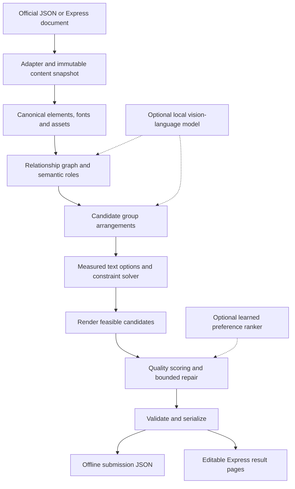

# Chameleon: end-to-end build plan

Prepared for a four-person team with 4–8 weeks and sufficient development GPUs/RAM. Research checked October 19, 2026. This is a proposed engineering plan, not an official judging rubric. Build a submission-ready version by week four; spend the remaining month improving measured quality and product reliability.

**The product:** turn one editable design into several useful aspect ratios while preserving every element, its identity, text, imagery, and brand styling. The engine should understand which objects belong together, explore alternative arrangements, fit the actual typography, and return editable geometry. Its output is a design document, not a generated bitmap.

**The central recommendation:** build a deterministic layout-and-rendering engine first. Add one small vision-language model for semantic interpretation/proposals and a lightweight preference ranker only if experiments justify them. Do not make the submission depend on an unreleased research model, a hosted API, or training a layout foundation model from scratch.

## 1. Requirements and decisions to settle

The supplied brief and starter establish a structured JSON-to-JSON task: `resize(source, target_canvas) -> {canvas, elements}`. Preserve element IDs and count, text content, font families, image assets, and required style fields. Only change fields permitted by the final rules. Keep foreground image proportions; treat backgrounds according to the starter's permitted fit behavior. The official renderer and structural checks determine what is actually evaluated. [Starter repository](https://github.com/jhaaj08/chameleon)

Keep a versioned rule matrix with four columns: field, permitted changes, authority, validation. Default rotation, opacity, z-order, fills, group membership, and rich-text styling to unchanged until an explicit rule permits a change. Never hide difficult elements through zero size, zero opacity, or placement outside the canvas. Preserve the original object and apply an allowlisted geometry patch rather than rebuilding every element from model output.

In week one, resolve these organizer dependencies without blocking the model-free engine:

- Final model whitelist, parameter cap, treatment of adapters and quantization, and whether training-only teacher models are restricted.
- Exact runtime architecture, CPU/RAM/GPU, time limit, network restrictions, and submission interface.
- Whether decorative bleed is permitted, how rotation affects bounds, and whether any style changes beyond font size are permitted.
- Whether the Round 1 viewer mentioned in the FAQ is mandatory; budget a simple viewer regardless.
- Whether experimental Express APIs are permitted for the demo, and what Stage 2 connectivity is allowed.

Development GPUs do not establish deployment feasibility. In particular, test the required Linux/amd64 container on the actual evaluation setup; do not assume a Mac host's native GPU acceleration is available inside that container. Docker's GPU paths depend on platform and configuration. [Docker GPU documentation](https://docs.docker.com/desktop/features/gpu/)

## 2. End-to-end architecture



Maintain one engine shared by the competition runner and product service. Keep Express access, networking, training, and annotation outside the engine package. The runtime engine must function with the neural components disabled.

The learning pipeline is separate: licensed source designs → verified conversion → retarget tasks → candidate outputs → human corrections/preferences → train/validation datasets → evaluated model versions. Freeze a test set before using feedback to improve the system.

## 3. Data extraction and canonical representation

**Three input adapters.** First implement the supplied challenge JSON adapter, then a Crello dataset adapter, then the Express document adapter. They feed the same internal representation, but their capabilities and fidelity differ. Never claim that an approximate dataset conversion is equivalent to a native challenge example.

For each design, store:

| Record | Required contents |
|---|---|
| Source | Stable design ID, provenance, license reference, original canvas, schema revision, source hash |
| Element | Original ID/type, immutable content/style snapshot, editable geometry, local and canvas transforms |
| Text | Exact Unicode content, font identity, size, alignment, supported style runs, line spacing, measured glyph metrics |
| Asset | Original file/reference, content hash, dimensions, alpha information, availability status |
| Relationships | Explicit groups, inferred groups, containment, alignment, reading order, intended overlap, confidence |
| Target task | Target width/height, source ID, task split, permitted edits, quality annotations |
| Reproduction | Adapter version, renderer version, font hashes, asset hashes, seed, model/configuration versions |

Use canvas pixel coordinates internally. Convert local/group transforms to canvas space for analysis while retaining the mapping needed to write edits back. Verify rotation origin, direction, and units per adapter. The latest Crello card describes rotation in degrees and font size in pixels; dataset versions and splits differ. Its `group` field is a design category, not an element `group_id`. Decode categorical font/type fields using that pinned dataset's feature definitions. [Crello schema and version notes](https://huggingface.co/datasets/cyberagent/crello/blob/main/README.md)

Do not blindly multiply all Crello coordinates by canvas dimensions or angles by pi based on another version's examples. Make a version-specific adapter and visually check its interpretation against the pinned reference renderer. Crello includes pre-rendered elements and has documented reconstruction limitations. Keep native text where representable; never flatten text into an image merely to make a conversion pass. [Crello renderer](https://github.com/CyberAgentAILab/cr-renderer)

**Conversion acceptance:** verify IDs, types, text, dimensions, layering, transform interpretation, asset correspondence, font availability, and source render fidelity. Route unsupported vector effects, inaccessible fonts, or irrecoverable text styling to a separate approximation/robustness pool. Record a reason instead of silently changing their semantics. Use absolute pixel difference and SSIM as diagnostics, followed by visual review; anti-aliasing differences make an exact pixel match an unsuitable universal acceptance rule.

The challenge renderer is the authority for challenge outputs. Add a health check proving that actual text and assets rendered; the starter's fallback placeholders must not pass unnoticed as successful rendering. Use its font measurement and wrapping behavior when choosing text geometry, including handling of long unbroken strings.

## 4. Building the training and evaluation data

**Start small enough to inspect.** The first milestone is 50 correctly converted designs, not a huge download. Expand to 500, then approximately 3,000 compatible sources if conversion quality holds. A sensible month-one target is 1,000 sources; month two can reach 3,000–5,000. These are planning targets, not prerequisites for the baseline.

Use four data pools:

1. **Official examples:** integration and regression fixtures; too few for training or convincing generalization claims.
2. **Crello-compatible sources:** diverse layouts for structural statistics, retrieval, stress tests, and training tasks. Retain dataset and underlying asset-license provenance. [Dataset and license information](https://huggingface.co/datasets/cyberagent/crello)
3. **Team-created native examples:** accurately represented logos, promotional cards, event posters, product offers, long text, and complex groups. These fill gaps left by conversion limits.
4. **Human-reviewed retarget examples:** the source, target size, corrected layout, and explicit quality annotations. These provide the strongest labels for the actual task.

For each eligible source, create approximately five target tasks covering a near-original ratio, square, portrait, landscape, and extreme banner. Include dimensions from the official samples, particularly 1600×400 and 728×90, but do not tune exclusively to them. Vary both aspect ratio and absolute size; identical ratios can have different readability constraints.

Three thousand sources times five targets gives roughly 15,000 task specifications. It does **not** give 15,000 correct target layouts. Generate candidates lazily, cache renders, and run expensive model experiments on a stratified subset before scaling.

**Split before augmentation.** Preserve the pinned dataset's existing source splits where possible. Detect duplicate and near-duplicate templates across them; remove cross-split leakage rather than moving test examples into training. For additional team-created data, use approximately 70/15/15 source-family splits. All variants, target ratios, asset substitutions, and corrections of a source stay together. Retrieval uses training sources only. Freeze an independent test subset and keep it out of prompts, tuning, preference-label collection for training, and model selection.

Duplicate detection combines normalized JSON fingerprints, asset hashes, and perceptual hashes of source renders. Treat visually similar campaign families as one split unit where practical.

**Three kinds of labels serve different purposes.**

| Dataset | Proposed size | Labels and use |
|---|---:|---|
| Semantic seed set | 300–500 sources | Roles, grouping, importance, intended overlap, and relation confidence; evaluate interpretation |
| Corrected retarget set | 100–150 sources × 3 targets | Human-edited layouts; measure achievable quality and supervise proposals |
| Candidate preference set | 1,500–3,000 pairs | A better / B better / tie / both unacceptable, plus failure tags; train ranking |

Reserve some corrected sources exclusively for test evaluation; their layouts must never become training exemplars. Double-label at least 20% of preferences, randomize left/right position, conceal the generating method, and adjudicate disagreements. Pair outputs from different algorithms and difficulty levels, not just obvious failures. Record text clipping, lost hierarchy, accidental overlap, bad grouping, awkward whitespace, and image distortion separately.

Synthetic examples are useful when their supervision is honest. Perturb a valid layout to train repair, mask geometry to study reconstruction, and use uniform scaling as a known baseline. Randomly changing the target ratio does not create ground truth. Teacher-generated retargets enter training only after independent validation/review; a model's own preference is not a human label.

Build a small annotation/review interface using the same web viewer as the demo. It should show source and target renders, support blind A/B choice, display diagnostic overlays, and export versioned JSONL annotations.

## 5. Algorithms in the core engine

**5.1 Validate and snapshot.** Check schema, uniqueness of IDs, finite dimensions, valid references, and positive target size. Snapshot immutable fields and assets. Distinguish malformed input from valid but difficult layouts. Preserve unknown fields unless the official serializer disallows them. Keep diagnostics outside the official output document.

**5.2 Infer semantic roles and relationships.** Begin with explicit `group_id` relationships. Infer additional relationships using proximity normalized by canvas size, common edges/centers, containment, font hierarchy, z-order, repeated styles, and meaningful overlaps. Estimate roles such as background, logo, hero image, headline, supporting copy, CTA, and decoration. Treat inferred roles as confidence-weighted hypotheses.

Use a weighted relation graph plus constrained agglomerative grouping. Do not merge every touching object into one connected component: a background or large underlay could otherwise connect the whole page. Separate rigid groups, such as an icon with a badge, from flexible groups, such as a heading and paragraph that can reflow. Preserve actual source group membership in output even when adding an internal grouping abstraction.

The optional VLM sees a source render and structured element summaries and returns role/group/relation proposals referencing known IDs. The parser rejects unknown IDs, duplicate membership, and invented content. Geometry-based inference remains available on failure. Do not rely on descriptive source IDs such as `headline` being present in unseen inputs.

**5.3 Generate diverse arrangement candidates.** Represent a candidate as a hierarchy of horizontal splits, vertical stacks, grids, overlays, and flexible groups. Propose preserved-composition, stacked, side-by-side, and banner arrangements, instantiated from the actual groups. Preserve information relationships while allowing their orientation to change: an image above a headline may become an image beside it.

Start with a beam width of 8 and a maximum of approximately 24 arrangement candidates. These are tunable engineering defaults. Penalize source displacement more strongly for similar aspect ratios and less strongly for extreme changes. A useful change measure is `abs(log(target_ratio / source_ratio))`.

Add optional retrieval from approved training examples using ratio, element counts, group counts, density, text/image balance, and hierarchy features. Normalize features and start with exact nearest-neighbor search; a vector database is unnecessary at this scale. Match retrieved group slots to current groups by minimum-cost bipartite assignment. SciPy provides this operation; its current implementation is a modified Jonker–Volgenant algorithm. Never drop unmatched groups. [SciPy assignment API](https://docs.scipy.org/doc/scipy/reference/generated/scipy.optimize.linear_sum_assignment.html)

LayoutPrompter is a useful reference for structured examples and candidate selection, but its archived implementation and generic metrics need adaptation for intentional overlaps and this challenge's preservation constraints. [LayoutPrompter source](https://github.com/microsoft/LayoutGeneration/tree/main/LayoutPrompter)

**5.4 Measure typography before solving placement.** For every text element, enumerate plausible widths and font sizes using the official font and wrapping implementation. Cache measured line count, glyph bounds, rendered height, and overflow. Use binary search where fit is monotonic, then verify the selected option by rendering. Handle rich text, explicit newlines, Unicode, and unbroken words explicitly.

Keep roughly 8–16 useful width/size options per text element after eliminating dominated alternatives. An option is dominated if another gives at least equal readability and fits in no more space. Readability floors are configurable quality preferences unless the official rules define hard floors. Use destination pixels and intended display size, not a single percentage of the source font.

Never paraphrase copy to fit. A destination may be too small for all text to remain comfortably readable. The engine must preserve content, report the quality limitation in its diagnostic channel, and return its best compliant layout instead of pretending the conflict is solved.

**5.5 Solve geometry using OR-Tools CP-SAT.** For each arrangement, optimize integer x/y coordinates and discrete choices for group/text sizes. Precompute rotated group extents for fixed rotations. Use fixed-point coordinates if subpixel placement is useful. CP-SAT operates on integer constraints and distinguishes feasible, infeasible, and unknown/time-limited outcomes. [OR-Tools solver documentation](https://developers.google.com/optimization/cp/cp_solver)

Hard constraints cover allowed mutations, valid element identity, required containment, preserved image aspect ratios, explicit locks, and selected non-overlap relationships. Backgrounds, intended underlays, text-on-image compositions, and existing intentional overlaps must not be subject to a blanket no-overlap constraint.

For unrelated groups, encode a disjunction: left of, right of, above, or below. Use fixed/precomputed group extents so the solver does not have to evaluate trigonometry or text shaping. Model soft alignment, spacing, hierarchy, whitespace, and source similarity through integer penalties. Solve a few priority stages or carefully bounded weighted objectives; do not let a tiny aesthetic gain compensate for unreadable text.

At timeout, keep a feasible incumbent. If there is no solution, relax inferred alignment/spacing or change the arrangement and retry within a fixed budget. Never relax immutable content constraints. Maintain a conservative baseline fallback. No fallback can guarantee both comfortable readability and a tiny canvas for arbitrarily large content; track this distinction explicitly.

**5.6 Render, score, and repair.** Use inexpensive geometry checks to shortlist approximately six candidates, then render those with the challenge renderer. Measure:

- Actual text overflow and clipping, including visible glyph bounds.
- Smallest text and importance-weighted readability.
- Unintended visible overlap, distinguishing transparent margins and intended overlays.
- Alignment consistency, spacing rhythm, and balanced use of space.
- Relative prominence of headline, image, logo, and CTA.
- Preservation of meaningful group relations and brand styling.
- Local contrast and background texture behind text, sampled from a render with that text omitted.
- Cropping or distortion of foreground imagery and loss of visible content.

Use padded diagnostic renders to detect off-canvas content; clipping can hide the evidence in a normal canvas render. Treat contrast and texture as heuristics that need human calibration, not universal aesthetic truth. Borrow metric ideas from RALF selectively; do not add a heavy vision backbone merely to compute simple geometry. [RALF metric implementation](https://github.com/CyberAgentAILab/RALF/blob/main/image2layout/train/helpers/metric.py)

Select the best candidate using a transparent score first. Then attempt up to two rounds of targeted local moves: expand a text box, redistribute space, swap group orientation, adjust a gap, or choose another measured font option. Re-solve affected groups, re-render, and retain only improvements. Bound candidate counts and repair work so bad inputs do not cause unbounded inference.

DesignSense supports investigating grouping, multiple proposals, and preference-based evaluation for retargeting. Its findings also motivate testing a task-specific ranker rather than trusting a generic aesthetic model. We are borrowing an architectural direction; a usable public release of its full pipeline was not verified. [DesignSense paper](https://arxiv.org/html/2602.23438v1)

**5.7 Serialize and validate again.** Patch the chosen geometry into the source snapshot. Check exact ID multiset/count, per-ID type/content/style invariants, asset references/hashes, legal fields, bounds policy, and finite numbers. Re-render the serialized result rather than a richer internal representation. The file that passes final validation must be the file returned by the competition interface.

## 6. Exact model inventory and training decisions

| Component | Recommended implementation | Training required? | Shipping priority |
|---|---|---|---|
| Structure extraction | JSON/Express adapters, transforms, schema checks | No | Required |
| Text fitting | Official renderer, glyph measurement, cached option search | No | Required |
| Relationships | Weighted graph and constrained grouping | No initially | Required |
| Candidate proposals | Layout grammar and beam search | No | Required |
| Geometry | OR-Tools CP-SAT | No | Required |
| Initial ranking | Measured penalties and ordered quality priorities | No | Required |
| Semantic/proposal VLM | Qwen3-VL-4B-Instruct, local inference | Optional LoRA later | Conditional |
| Preference ranker | L2-regularized pairwise logistic regression | Small human-labeled dataset | Preferred month-two upgrade |
| Research challenger | LaDeCo / elem2design | Released adapter plus compatible base, optional adaptation | Optional experiment only |
| OCR / segmentation / image generation | Not needed for structured-input core | None | Exclude from initial scope |

**Qwen3-VL-4B-Instruct is the first VLM to evaluate**, not a claim that it is the best layout model. It has a public model card and Apache-2.0 licensing, but challenge eligibility and deployment performance still need confirmation. Its role is to interpret visual hierarchy and propose group arrangements; the solver owns exact geometry and the renderer owns text fit. Use the same backbone for both tasks instead of several separate large models. [Model card](https://huggingface.co/Qwen/Qwen3-VL-4B-Instruct)

Start with frozen inference and a compact, schema-constrained output. Set bounded image resolution, context length, output length, and retries. Do not let a failed response bypass validation. Keep model versions pinned. Compare full precision and quantized inference if the allowed runtime supports them; measure real RAM/VRAM and quality rather than estimating deployment feasibility from parameter count alone.

**LoRA is a gated experiment.** Train only after a baseline experiment identifies repeatable errors in semantic interpretation or candidate proposals and enough reviewed examples exist. Inputs: source render, structured elements, target size, and permitted changes. Targets: reviewed roles, groups, relations, and arrangement structures. Do not train on invented content or silently approximate labels. Evaluate generalization by source family and aspect-ratio severity. Use early stopping on validation performance and keep the test set untouched. PEFT provides the low-rank adapter machinery. [PEFT LoRA documentation](https://huggingface.co/docs/peft/main/package_reference/lora)

**The small ranker is more likely to pay off than extensive VLM tuning.** Extract a fixed feature vector from each rendered candidate: readability, overflow, relation preservation, overlap, hierarchy, alignment, spacing, and crop quality. Standardize using training data only. For candidates A and B, fit `P(A preferred) = sigmoid(w · (features_A - features_B))` with regularization. Rank each candidate by `w · features`. Exclude ambiguous ties from the initial directional loss; keep both-unacceptable labels for rejection/diagnostics. Split by source family, randomize order, and never allow ranking to override hard validation. [Logistic regression implementation](https://scikit-learn.org/stable/modules/generated/sklearn.linear_model.LogisticRegression.html)

**LaDeCo is a comparison, not a dependency.** Its released artifacts involve a Llama-3.1-8B base, visual components, and adapters; download and inspect the complete inference chain before committing. Model/adaptor licensing and base-model terms need separate accounting. Its layer-based composition ideas are useful, but it is not a ready-made challenge retargeter. Run a small pilot only after the baseline is stable. [Code](https://github.com/microsoft/elem2design), [released artifacts](https://huggingface.co/microsoft/elem2design)

Do not schedule parallel integration of LayoutDM, FlexDM, LayoutCorrector, PosterLlama, and multiple unreleased projects. Keep them as references for later experiments. Four people will get more value from a reliable renderer, high-quality labels, and a well-tuned search/repair loop.

**Promotion gate for any learned component:** same test inputs, same repair/validation pipeline, blinded human preference improvement, no increase in content violations, acceptable tail latency/memory, and confirmed challenge eligibility. If it fails a gate, leave it out of the submission. The product can still be strong without a large model.

## 7. Evaluation and experimentation

Keep six comparable systems: uniform scale; group-aware heuristic; heuristic plus solver; solver plus render/repair; the same engine plus VLM proposals; and the best configuration plus learned ranking. Add a LoRA variant only if trained. This identifies which additions actually help.

Evaluate on source-family-held-out tasks stratified by element count, text density, images, rotations/groups, source quality, language/font support, and aspect-ratio change. Run a larger automated suite and a smaller carefully reviewed human suite. Do not let abundant easy examples hide failures on extreme banners.

| Measure | How to use it |
|---|---|
| Structural/content compliance | Exact invariants; release gate is zero violations on the supported valid-input suite |
| Renderer success | Count real asset/font renders separately from diagnostic placeholders |
| Text failures | Overflow, clipping, tiny text, and unavailable glyphs reported separately |
| Image/group failures | Distortion, accidental occlusion, broken rigid groups, or missing visible content |
| Human preference | Blind comparison against strongest baseline, with ties and unusable outputs reported |
| Reliability | Exceptions, timeouts, fallback rate, repeatability, missing-resource behavior |
| Performance | Cold start, median/p95 duration, peak RSS/VRAM, container size, cache size |
| Product fidelity | Editability, source/result correspondence, text/style preservation, stale-document handling |

An internal improvement target is at least 60% preference wins over the strongest month-one baseline among decisive comparisons, with confidence intervals and tie/unacceptable rates reported. This is a team target, not a predicted result or official score. Bootstrap confidence intervals by source, not by treating multiple targets of one source as independent designs.

Use meaningful transformation tests: reorder the input list, rename IDs, change source scale, and exercise equivalent group transforms. The result should preserve meaning and invariants; exact pixel equality is not always appropriate. Add adversarial fixtures for long words, empty text, Unicode, near-transparent assets, intentional overlaps, missing files, rotated groups, and more elements than the model's training examples contain.

Profile before optimizing. Cache font measurements, static asset decodes, source analysis, and renders keyed by complete content/configuration hashes. Render at lower resolution for cheap screening and full resolution for final checks where measurements remain consistent. Neural inference is optional and must have a timeout fallback. Establish numerical runtime budgets from week-one measurements and the organizers' actual limit, rather than promising an unmeasured latency.

## 8. Complete product and Adobe Express integration

The user flow is: select a design → choose one or more output sizes → optionally lock important groups or emphasize a headline/image → generate → compare three distinct options → apply chosen options as editable designs → make normal edits in Express. Show specific issues such as “body text is very small at this size” rather than internal model/solver terminology.

Build a React/TypeScript panel with Adobe's UI components, an Express document-sandbox bridge, and a Python service around the same engine. The iframe handles UI and service communication; the sandbox handles document access and mutations through supported APIs. [Express architecture](https://developer.adobe.com/express/add-ons/docs/guides/learn/platform-concepts/architecture)

**Week-one capability spike:** read nested nodes, transforms, supported text styles, font identities, groups, image references, and bounds; create a destination; preserve native elements; apply geometry; and verify editability. Confirm actual APIs for cloning/recreation and page management before promising broad document support. Maintain a capability matrix by node type. [Document API reference](https://developer.adobe.com/express/add-ons/docs/references/document-sandbox/document-apis/)

Individual-element image renditions are currently experimental and documented as unsuitable for distributed add-ons until stable. Therefore do not make the distributed product depend on them. Test a stable path using document metadata plus page previews for analysis, retained native nodes for editing, and accessible original assets where supported. If assets cannot be accessed, use managed templates/user-provided assets or explicitly restrict supported documents. Experimental APIs may be a prototype option only if the competition permits them. Page previews must not be repurposed to circumvent export restrictions. [Adobe rendition guidance](https://developer.adobe.com/express/add-ons/docs/guides/learn/how-to/create-renditions)

The offline challenge path has local assets and its own renderer; Express may render fonts/effects differently. Validate results in Express as well as the engine preview. Do not imply an exact WYSIWYG round trip before this is demonstrated. Avoid flattening text or whole pages to conceal unsupported native content.

**Product service contract:** a request contains a versioned document snapshot, accessible assets, target dimensions, optional locks/emphasis, and an input hash. A job produces candidates, previews, diagnostics, and geometry patches keyed by original IDs. Provide job status/cancellation and bounded resource use. Verify the source hash/revision before applying; if the user edited the design during generation, ask them to regenerate or rebase instead of applying stale coordinates.

Use HTTPS in the connected demo environment and test the add-on's networking requirements early. Keep deployment configuration separate from Stage 1's offline runner. Start with a single service and per-job files; a database, distributed queue, and authentication system become necessary only when the deployment actually supports multiple users and persistent jobs. Apply mutations to a new result page/document when supported, retain the source, and test cancellation and partial failure recovery.

The developer viewer should share preview components with the user product but expose extra overlays: group boxes, relationships, intended overlaps, text bounds, scores, and failure reasons. This will materially reduce debugging time.

## 9. Team ownership and delivery schedule

| Person | Primary responsibility | Secondary responsibility |
|---|---|---|
| A | Data adapters, provenance, annotations, evaluation | Final rules/compliance checks and regression triage |
| B | Typography, grouping, geometry solver, repair | Offline packaging and profiling |
| C | Retrieval, VLM experiments, preference ranker | Candidate search and experiment reproducibility |
| D | Express integration, viewer, service, product flow | Native editability testing and demo/story |

Freeze shared schemas in the first few days. B and D review the geometry-patch contract together; A and C review labels/splits together. Everyone participates in one weekly blind design review. Keep one stable branch/container throughout; experimental model work stays behind configuration switches.

| Week | Work and concrete exit criteria |
|---|---|
| 1 | Pin brief/starter/schema; run true renderer in container; approve canonical representation; inspect 50 conversions; prototype Express read/apply; establish CPU/memory/latency measurements; freeze seed evaluation sources |
| 2 | Reach 500 compatible sources; build identity-preserving baseline, graph groups, measured text options, and viewer; support simple portrait/landscape changes end to end |
| 3 | Add candidate grammar, CP-SAT placement, selective overlap rules, render metrics and repair; run small frozen-VLM/retrieval experiments; begin blind preference labels; demonstrate an editable Express result |
| 4 | Freeze v1 offline submission and usable product flow; benchmark 1,000-source-scale data where feasible; pass preservation checks; produce README, model-free container, viewer, and a complete demo recording |
| 5 | Grow reviewed data and stress cases; train small ranker; run LoRA only if earlier evidence supports it; expand supported Express node types based on observed demand |
| 6 | Run ablations, tune on validation only, select final neural configuration or retain model-free; validate runtime eligibility and exact deployment performance; harden multi-size generation and apply/cancel behavior |
| 7 | Freeze model/configuration; run held-out tests and manual review; repair systemic defects; validate clean-machine/offline reproduction; rehearse live demo and failure recovery |
| 8 | Final regression, submission artifacts, pitch/video, installation/run documentation, licenses and model/data manifest; retain buffer for organizer changes |

**If the deadline is four weeks:** ship the deterministic engine, retrieval only if already useful, the render/repair loop, strict validation, viewer, and a focused Express workflow. Cut LoRA, LaDeCo integration, broad unsupported node coverage, and ambitious cloud infrastructure. Keep blind evaluation and native editability verification. Freeze functionality several days before submission.

## 10. Repository and interfaces

```text
engine/
  resize.py              # Required challenge entry point
  canonical.py           # Internal typed representation
  invariants.py          # Allowlisted patches and preservation checks
  relationships.py       # Roles, graph, rigid/flexible groups
  proposals.py           # Layout grammar and bounded beam search
  typography.py          # Renderer-compatible measurements/options
  constraints.py         # CP-SAT model and fallback selection
  rendering.py           # Official renderer wrapper and health checks
  metrics.py             # Geometric and rendered quality features
  ranking.py             # Heuristic or learned scorer
  repair.py              # Bounded refinement
  models/                # Optional model adapters, no network dependency
data_tools/              # Crello adapter, deduplication, manifests, tasks
training/                # Preference ranker and optional LoRA experiments
evaluation/              # Frozen splits, fixtures, ablations, reports
service/                 # Job API wrapping the engine
express_addon/           # Panel and document-sandbox bridge
viewer/                  # Preview, diagnostics, annotation interface
configs/                 # Rules, solver limits, runtime/model configuration
```

Suggested internal interfaces are `analyze(source)`, `propose(analysis, target)`, `solve(proposal, text_options)`, `render(layout)`, `score(render, layout)`, and `validate(source, output)`. Keep these ordinary deterministic calls where possible. Models return typed proposals, never executable code. No multi-agent framework is needed for this runtime.

Pin compatible versions for Python, renderer/font libraries, NumPy, SciPy, OR-Tools, schema validation, and optional PyTorch/Transformers/PEFT. Use the starter's supported Python/environment as the compatibility anchor. Keep training-only dependencies out of the final container. Check the final dependency and artifact licenses, rather than assuming a repository license covers its base weights or source artwork.

## 11. Release acceptance and demonstration

The release bundle contains the working `resize` entry point, all runtime dependencies, required fonts/assets where redistribution is permitted, any allowed weights/adapters, a network-disabled container that actually runs, sample commands, configuration, license notices, a reproducibility manifest, evaluation results, and viewer/add-on instructions. Run from a clean environment with caches removed to catch implicit model downloads or local file assumptions.

Release only after the supported valid-input suite has no content/identity violations; genuine rendering succeeds; malformed/missing-resource cases are explicitly handled; timeouts retain a valid result where possible; and the product preserves editable text and elements on its supported document types. Report quality failures separately from structural compliance. Do not claim general quality from the three supplied examples.

The demo should use one moderately complex design across portrait, landscape, and a narrow banner; show why groups move together; compare alternative arrangements; lock one important group and regenerate; then edit resulting text in Express to prove the document remains native. Include one difficult case with an honest readability limitation. Show measured improvement against uniform scaling and the strongest baseline, using held-out examples and clearly identified internal metrics.

**First ten working days:** make the renderer trustworthy, prove the Express editing path, curate 50 then 500 valid sources, freeze evaluation families, implement preservation validation and measured typography, and complete one full source-to-editable-result path. These foundations determine whether later model work improves the product or merely produces attractive screenshots.
